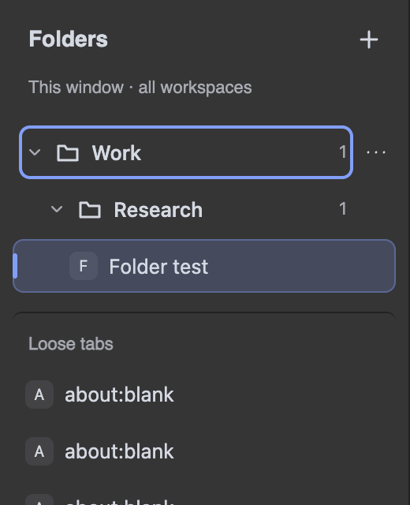

# Vivaldi Tab Folder

**Nested, Arc-inspired tab folders for Vivaldi desktop.** Organize live tabs into collapsible folders and subfolders, with drag-and-drop, keyboard controls, and locally saved organization.

> **Experimental macOS UI mod, not an official Vivaldi feature.** Tested against **Vivaldi 8.3.4191.26**. Persistent installation modifies signed app resources and can prevent the app from launching. Start with the isolated trial below. Other versions and platforms are not verified.



## Features

- Nested folders with rename, collapse, reorder, and drag-and-drop.
- Move menus as an alternative to dragging; arrow-key tree navigation and keyboard-friendly dialogs.
- Folder organization saved locally using Vivaldi's existing persistent tab/window IDs.
- Removing a folder keeps tabs open and unwraps its contents.
- Native tab controls remain available. Private windows are excluded.

## Requirements

| Component | Supported / required |
| --- | --- |
| Browser | Vivaldi **8.3.4191.26**, installed at `/Applications/Vivaldi.app` for the trial launcher |
| Platform | macOS; other platforms are not implemented |
| Build and trial | Node.js **22+** and npm |
| Installer and tests | Python **3.9+** |
| Dependencies | No npm or Python dependencies to install |

## Quick start: safe, temporary trial

1. Clone the source:

   ```sh
   git clone https://github.com/larrysammii/vivaldi-tab-folder.git
   cd vivaldi-tab-folder
   ```

2. Open the isolated test window:

   ```sh
   npm run try
   ```

3. Click **+** beside **Folders**. Use a folder's **… → New subfolder** to nest it.

The trial uses a **separate profile in `.local/test-profile`** and injects the sidebar **in memory**. It does not edit your installed app or normal browsing profile. Loopback debugging is enabled only for that isolated process; do not sign into Sync or use that profile for sensitive browsing.

**Quitting Vivaldi removes the trial's injected UI. Run `npm run try` again to reload it.** Folder data remains in the test profile, but reopening Vivaldi normally does **not** load the mod. The trial and your normal profile do not share folder data.

## Persistent installation

For startup loading in your normal Vivaldi app, follow the [installation and rollback guide](docs/installation.md).

**Read the signing warning first.** This is a version-checked app-resource patch, not an extension-store installation. It invalidates the vendor resource seal. The project does not re-sign applications, remove quarantine, disable macOS protections, or modify the browser executable. A patched app copy's normal startup has not yet been verified; the real-browser functional checks use in-memory loading.

Read-only compatibility plan:

```sh
npm run build
python3 tools/install.py plan --app /Applications/Vivaldi.app
```

Updates can replace the hook. Unknown versions are refused rather than patched speculatively. The installer has explicit install/uninstall commands, exact-byte HTML backup, and hash checks; see the guide before enabling writes.

## Use folders

1. Create a top-level folder with **+** beside **Folders**.
2. Create a child using **… → New subfolder**.
3. Drag a tab onto a folder, or use its **Move to folder** button. Drop onto another tab to insert before it.
4. Click a folder to collapse it. **Move folder** changes its parent and sibling position without dragging.
5. **Remove folder (keep tabs)** unwraps its contents; the tab's separate **×** button closes the tab.

Keyboard: **↑ / ↓ / Home / End** navigate; **→ / ←** expand and collapse; **Enter / Space** activate; **F2** renames a folder; **Shift+F10** opens actions. Dialogs support **Tab**, **Shift+Tab**, and **Escape**.

## How it works

The build combines a pure tree model, CSS, and a small UI controller into `dist/arc-folders.js`. The controller runs in Vivaldi's shared `main.html` UI context and mounts a sidebar in each normal browser window. It uses the browser's existing tab/window APIs, not a modified Chromium executable.

Hierarchy, names, order, collapsed state, and tab assignments live under `arc-folders.state.v1` in local extension storage. Assignments use existing `vivExtData.ext_id` UUIDs; the mod does not edit that metadata or match tabs by URL. No URLs, page contents, or tab titles are copied into folder storage. The mod has no analytics, server, remote fonts, or remote assets.

See [architecture](docs/architecture.md) for the module boundaries, event flow, and persistence details.

## Limitations

- Folders are **per window**, including all of that window's workspaces. Workspace-specific trees and Vivaldi Sync are not implemented.
- These folders organize open tabs. Arc-style archives, saved closed links, and Spaces are not implemented.
- Native tab stacks appear flattened in this sidebar; their native state is not changed. The original tab bar remains visible as a fallback.
- Internal APIs and UI selectors can change. Other Vivaldi builds, operating systems, and large-tab-count performance are not verified.
- Browser-restored tabs retain assignments when their native persistent IDs are restored. No guarantee is made for fresh profiles, discarded sessions, or tabs reopened with new identities.

## Development and verification

```sh
npm run check           # syntax, model/installer tests, deterministic build
npm run try             # launch the isolated browser and load the mod
npm run test:vivaldi    # real pointer/keyboard and sidebar checks
npm run test:lifecycle  # separate/private windows and isolated process restart
```

The lifecycle test closes and relaunches **only the project-owned test browser process**. Browser tests use synthetic local pages and restore their temporary folder state. Do not run them against a profile you use for real browsing.

The test suite includes 13 model tests and 10 installer tests. Real-browser checks cover nesting, real pointer drag and first-use reorder, collapse, persistence across mod reload and process restart, keyboard focus, private-window exclusion, and removal without closing tabs. This does **not** establish that macOS will launch a permanently patched signed app.

Contributions: [CONTRIBUTING.md](CONTRIBUTING.md). Security reports: [SECURITY.md](SECURITY.md). Research and verification boundaries: [investigation](docs/investigation.md), [loading references](docs/loading-research.md).

## License and affiliation

The mod source is [MIT licensed](LICENSE). No Vivaldi or Arc application code, binaries, browsing profiles, or reverse-engineering evidence bundles are distributed in this repository. The screenshot uses synthetic local test content.

This project is independent of Vivaldi Technologies and The Browser Company. Vivaldi and Arc names and marks belong to their respective owners.
