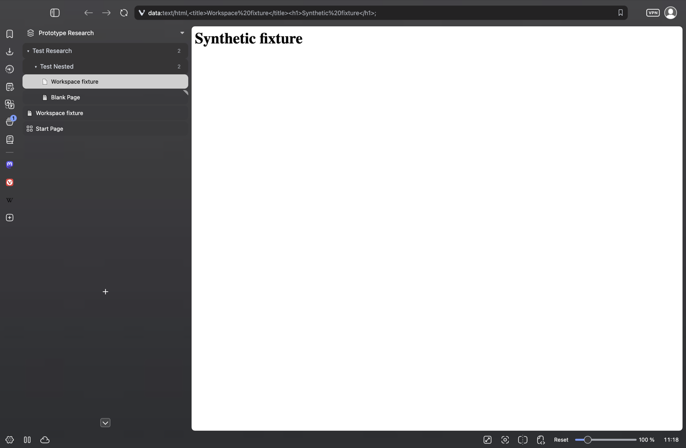

# Vivaldi Tab Folder

**Workspace-scoped, nested folders inside Vivaldi's native vertical tab bar.** Right-click the tab bar to create a folder, then drag native tabs into it. No separate Folders panel, extra toolbar, or drag handles.

> **Experimental macOS prototype, not an official Vivaldi feature.** Target: **Vivaldi 8.3.4191.26**. The default trial loads in memory in a dedicated disposable profile. It does **not** patch the installed app or use your normal browsing profile. Persistent installation of this workspace prototype is not provided.

## Try it safely

Requires macOS, Vivaldi at `/Applications/Vivaldi.app`, Node.js **22+**, npm, and Python **3.9+**. No npm or Python dependencies need installing.

1. Get the source:

   ```sh
   git clone https://github.com/larrysammii/vivaldi-tab-folder.git
   cd vivaldi-tab-folder
   ```

2. Open the isolated prototype:

   ```sh
   npm run try
   ```

3. Choose or create a workspace using Vivaldi's normal workspace switcher.
4. **Right-click anywhere in the vertical tab bar → New Folder.** Type the name directly in the new row—no naming dialog. **Enter** or clicking away saves; **Escape** cancels. Right-click a folder for **New Subfolder**, inline rename, move, or removal.
5. Drag an actual native tab over a folder: a distinct highlight shows the valid destination **before you release**. Closed folders stay closed after the drop. Switching workspaces switches folder trees.

The interactive trial selects left-side tabs **only in `.local/workspace-profile`**. For the right side:

```sh
npm run try:workspace -- --side=right
```

The app files and normal profile stay unchanged. Loopback debugging is enabled for the isolated process only. **Do not sign in, enable Sync, or use this disposable profile for sensitive browsing.** Quitting the test browser unloads the prototype; run the command again to reload it. Folder state stays in the isolated profile.

## What the prototype does

- Keeps native tabs and adds folder headers to the same strip. **Inside folders:** close a loaded tab to unload its page while keeping its entry; close an unloaded entry to remove it. Opening it reloads and resets the cycle. Outside folders, close stays normal.
- Gives each workspace an independent tree. The default/home view is scoped by persistent window identity.
- Adds folder actions to native context menus. **Move to Folder** in the context menu is a non-drag alternative.
- Saves hierarchy and placements locally under a separate prototype storage key. No URLs, page contents, or tab titles are copied into folder state.
- Excludes private contexts and horizontal tab bars; unexpected native layouts fall back to the unchanged native list.

The folder-only close rule applies to **×, ⌘W, middle-click and individual Close Tab**. Unloading selects Vivaldi's normal next tab, or opens a Start Page if no other tab exists. Bulk close, window close and quit stay native. [Lifecycle details and tests](docs/folder-tab-lifecycle.md).

Keyboard: folder buttons support **← / →** to collapse/expand, **↑ / ↓ / Home / End** navigation, and **F2** for inline rename. Naming preserves drafts/caret across refreshes and ignores Enter during IME composition. **Escape** cancels a new row or restores the previous name; clicking away from an empty new name keeps `Untitled`. The move-parent dialog retains standard **Tab / Escape** behavior. Native tab keyboard behavior remains owned by Vivaldi.



## Verification and boundaries

```sh
npm run check                   # all pure/installer tests and both builds
npm run check:workspace         # workspace/native-bridge tests and prototype build
npm run test:workspace-browser  # isolated native-UI checks
```

Automated checks use **`.local/workspace-qa-profile`**, separate from the interactive trial. They exercise real right-click, pointer, and keyboard events; inline naming and draft preservation; valid drop feedback; workspace/nesting behavior; and the same-tab **+ → navigation/title update → folder drag → unload → remove** workflow. Separate lifecycle checks cover reopening, automatically unloaded tabs, native context commands, queued closes, focus and the last-tab Start Page. Private exclusion, both vertical sides, fallback, reinjection, cleanup, and the installed app's vendor signature are checked too.

**Automation intercepts platform-menu selection and OS drag start.** It then routes the actual native menu command and serialized tab-drop payload through the prototype and Vivaldi's drop consumer. This avoids an OS drag loop that CDP cannot reliably control. It is not a claim of full physical-mouse/platform-menu verification, process-restart persistence, performance at large tab counts, or production readiness.

**Use a named workspace for the current trial.** A Home/default-view diagnostic hit a native rendering mismatch even with the mod disabled, so the new close lifecycle is not verified there.

Native stacks and other complex tab layouts are not fully supported; unknown rows pause the projection rather than being replaced. Other Vivaldi versions/platforms, browser Sync, archives/saved closed links, and automatic migration from the old sidebar are not implemented. See [prototype details](docs/workspace-prototype.md).

## Legacy sidebar and installer

The earlier **window-wide standalone sidebar** is retained for reference and regression checks:

```sh
npm run try:legacy
```

It uses `.local/test-profile` and different storage. `tools/install.py` and the [legacy installation/rollback guide](docs/installation.md) apply **only to that older sidebar**, not this workspace prototype. Do not use that installer expecting workspace-native folders. Changing signed app resources can prevent Vivaldi launching; the prototype deliberately avoids those changes.

Legacy documentation: [architecture](docs/architecture.md), [investigation](docs/investigation.md), [loading research](docs/loading-research.md).

## License and affiliation

The mod source is [MIT licensed](LICENSE). No Vivaldi/Arc application code, binaries, browsing profiles, or reverse-engineering evidence bundles are distributed. Screenshots use synthetic local data. The mod has no analytics, server, remote fonts, or remote assets.

Independent of Vivaldi Technologies and The Browser Company. Vivaldi and Arc names/marks belong to their owners. Contributions: [CONTRIBUTING.md](CONTRIBUTING.md). Security reports: [SECURITY.md](SECURITY.md).
